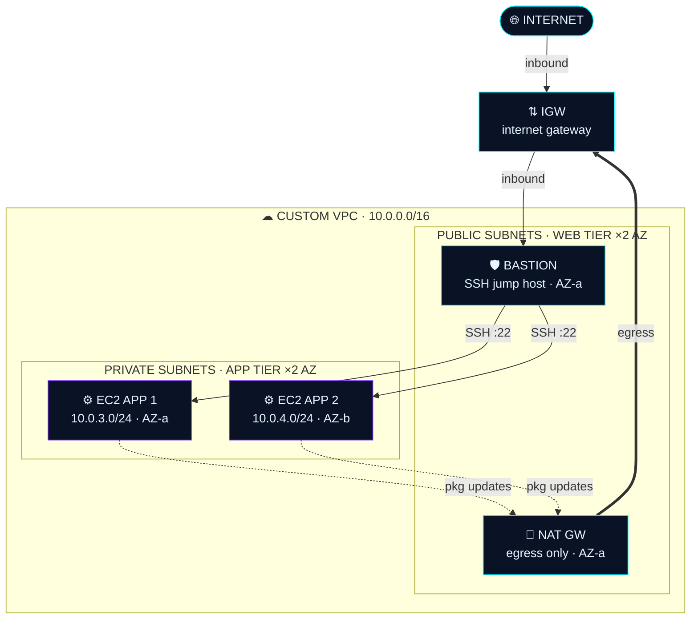

<div align="center">


<a href="https://github.com/Incryster"></a>

<br/>


<br/>

[](mailto:Abhilashantony17@gmail.com?subject=Let%27s%20build%20in%20the%20cloud)
[](https://www.linkedin.com/in/abhilash-t-anthony-74a529260)
[](mailto:Abhilashantony17@gmail.com?subject=Opportunity%20for%20Abhilash%20%E2%80%94%20Cloud%20%2F%20DevOps)

<br/>

| `5+` | `15+` | `7` | `∞` |
|:---:|:---:|:---:|:---:|
| **CLOUD BUILDS** | **TOOLS DEPLOYED** | **AWS DOMAINS** | **AUTOMATE-EVERYTHING** |

</div>

---

## `01 // SYSTEM SHELL` &nbsp;→&nbsp; INTERACTIVE TERMINAL

```bash
abhilash@cloud:~$ whoami
Cloud Engineer | BCA Graduate (2026) | AWS-focused builder

abhilash@cloud:~$ cat skills.conf
cloud      = ["AWS","VPC","IAM","S3","EC2","Lambda","CloudFront"]
devops     = ["Docker","Terraform","GitHub Actions","CloudFormation"]
scripting  = ["Python","Bash","Linux"]
mindset    = "least-privilege, automate-everything, build-in-public"

abhilash@cloud:~$ cat mission.txt
Build, secure and automate cloud infrastructure.
Learn fast. Ship real AWS projects.

abhilash@cloud:~$ status --now
[OK] Seeking Cloud Engineer / Junior DevOps opportunities

abhilash@cloud:~$ sudo hire-me
[sudo] password for recruiter: ********
ACCESS GRANTED ✔ — recruiter fast-track unlocked
Priority channel established. Response time < 24h:
→ Abhilashantony17@gmail.com
```

---

## `02 // TECH ARSENAL` &nbsp;→&nbsp; WEAPONS OF CHOICE

<div align="center">


</div>

| Tool | Category | Tool | Category | Tool | Category |
|:--|:--|:--|:--|:--|:--|
| **AWS** | CLOUD | **Docker** | DEVOPS | **Terraform** | IaC |
| **GitHub Actions** | CI/CD | **Python** | LANG | **Bash** | SCRIPT |
| **Linux** | OS | **Nginx** | SERVER | **Apache** | SERVER |
| **Git** | VCS | **GitHub** | VCS | **React** | WEB |
| **Node.js** | RUNTIME | **MongoDB** | DB | **Firebase** | BAAS |

### `02.1 // CAPABILITY MATRIX` &nbsp;→&nbsp; AWS DOMAIN COVERAGE

| Domain | Services | Count |
|:--|:--|:--:|
| ⚡ **COMPUTE** | `EC2` `Auto Scaling` `ELB` `Elastic Beanstalk` `Lambda` | 5 |
| 📡 **NETWORKING** | `VPC` `NAT/IGW` `NACLs` `Security Groups` `Peering` `Transit Gateway` `Route 53` `CloudFront` | 8 |
| 💾 **STORAGE** | `S3` `EBS` `EFS` `AWS Backup` | 4 |
| 🛡 **SECURITY** | `IAM` `STS` `KMS` `ACM` `GuardDuty` `Inspector` `Organizations` | 7 |
| 📈 **MONITORING** | `CloudWatch` `CloudTrail` `Systems Manager` | 3 |
| 🔗 **INTEGRATION** | `EventBridge` `SNS` `SQS` `SES` | 4 |
| 🗄 **DATABASES** | `RDS` `DynamoDB` `MongoDB` | 3 |

---

## `03 // FEATURED BLUEPRINT` &nbsp;→&nbsp; CUSTOM VPC ARCHITECTURE

> Public / private tiers across 2 AZs with a bastion jump host and NAT egress. `10.0.0.0/16` · 4 subnets · defense in depth with NACLs + Security Groups.



**Traffic layers:** 🔵 Inbound · 🟣 SSH · 🟢 Updates · 🟠 Egress

<details>
<summary><b>NODE INTEL</b> — click to expand</summary>

| Node | Intel |
|:--|:--|
| **INTERNET / EDGE** | User traffic resolves via Route 53 and enters the VPC through the Internet Gateway. Nothing reaches private tiers directly. |
| **INTERNET GATEWAY** | Horizontally scaled, redundant VPC edge component. The public route table points `0.0.0.0/0` here. |
| **BASTION HOST** | Hardened SSH jump box in the public subnet. Security Group allows `:22` only from a trusted CIDR — the single door into private instances. |
| **NAT GATEWAY** | Lets private instances reach the internet for package updates. Outbound-only: the internet cannot initiate connections back in. |
| **EC2 · APP 1** | Private subnet, AZ-a, no public IP. Reachable only via the bastion; egress flows through the NAT Gateway. |
| **EC2 · APP 2** | Private subnet, AZ-b, no public IP. Multi-AZ placement keeps the app tier resilient to a single-AZ failure. |

</details>

---

## `04 // MISSION LOG` &nbsp;→&nbsp; DEPLOYED PROJECTS

> Real AWS builds, shipped in public. Open a mission file for architecture notes and deploy logs.

### 🌐 LOG 001 — Custom VPC Architecture &nbsp; 
2 public + 2 private subnets across 2 Availability Zones. Bastion host access, NAT Gateway egress, layered NACLs and VPC peering — a production-shaped network built from scratch.

`VPC` `EC2` `NAT` `NACL` `PEERING`

<details>
<summary><b>OPEN MISSION FILE →</b></summary>

- ▸ 4 subnets across ap-south-1a / 1b with clean CIDR plan
- ▸ Bastion-only SSH into private tier — no public IPs on apps
- ▸ NACLs + Security Groups for defense in depth
- ▸ VPC peering with correctly scoped route tables

```bash
$ terraform apply -auto-approve
…
Apply complete! Resources: 18 added, 0 changed, 0 destroyed.
Outputs: vpc_id = vpc-0f27a… · subnets = 4 · azs = ap-south-1a/1b
```
</details>

### 🔐 LOG 002 — Secure Static Website &nbsp; 
S3 hosting locked behind a least-privilege bucket policy, fronted by CloudFront with ACM HTTPS and a Route 53 custom domain. Versioning and CORS configured for safe rollbacks.

`S3` `CLOUDFRONT` `ACM` `ROUTE 53`

<details>
<summary><b>OPEN MISSION FILE →</b></summary>

- ▸ Bucket fully private — CloudFront Origin Access Control only
- ▸ Versioning enabled for instant rollback
- ▸ HTTPS everywhere via ACM certificate + redirect policy
- ▸ Custom domain aliased through Route 53

```bash
$ aws s3 sync ./dist s3://at-static-site --delete
upload: 42 files · 1.8 MB
$ aws cloudfront create-invalidation --paths "/*"
Invalidation I3K9… Completed · HTTPS ✓ · OAC ✓
```
</details>

### 🛡 LOG 003 — IAM Security Lab &nbsp; 
A least-privilege playground: scoped policies, root account hardening with MFA, and cross-account access using STS temporary credentials instead of long-lived keys.

`IAM` `MFA` `STS`

<details>
<summary><b>OPEN MISSION FILE →</b></summary>

- ▸ Root account locked down with hardware-grade MFA hygiene
- ▸ Policies written and verified with the IAM policy simulator
- ▸ Cross-account role assumption via STS — credentials expire in 1h
- ▸ Zero wildcard admin policies in the final state

```bash
$ aws sts assume-role --role-arn arn:aws:iam::2211…:role/CrossAccountAudit
Credentials: ASIA… · Expiration: +1h
Access Analyzer: 0 unused permissions · MFA: enforced ✓
```
</details>

### ⚡ LOG 004 — Serverless EC2 Scheduler &nbsp; 
Lambda + EventBridge automatically start and stop EC2 instances on a schedule — cutting off-hours compute cost with a scoped execution role and full CloudWatch observability.

`LAMBDA` `EVENTBRIDGE` `CLOUDWATCH`

<details>
<summary><b>OPEN MISSION FILE →</b></summary>

- ▸ Cron rules for office-hours start / evening stop
- ▸ Execution role scoped to specific instance ARNs only
- ▸ Every run logged and metric-tracked in CloudWatch
- ▸ Zero servers to babysit — fully event-driven

```bash
[EventBridge] cron(0 19 * * ? *) → lambda:ec2-scheduler
[λ] stopped 4 instances · duration 412ms · role: scoped ✓
[CloudWatch] OffHoursSaved ↑ · alarm state: OK
```
</details>

### 📦 LOG 005 — Elastic Beanstalk Deployment &nbsp; 
Sample application running on managed Beanstalk environments with auto scaling, load balancing, health monitoring and rolling deployments — platform power without the boilerplate.

`BEANSTALK` `ELB` `AUTO SCALING`

<details>
<summary><b>OPEN MISSION FILE →</b></summary>

- ▸ Managed environment with ALB + Auto Scaling group
- ▸ Rolling deploys with automatic health gating
- ▸ Environment health dashboards and event stream
- ▸ Config-as-code via saved configuration templates

```bash
$ eb deploy production-env
INFO: Environment health has transitioned to Green.
INFO: Rolling update complete · 2/2 instances InService ✓
```
</details>

---

## `05 // ACTIVE OPERATIONS` &nbsp;→&nbsp; CURRENT FOCUS

> What's on the workbench right now — tracked like missions, shipped like products.

| | Operation | Progress |
|:--:|:--|:--|
| 🏗 | **Terraform IaC**<br/>Modular VPC + EC2 stacks, remote state, workspaces and clean variable design. |  |
| 🐳 | **Dockerised Apps**<br/>Multi-stage builds, compose workflows, slim images and registry pushes. |  |
| 🔁 | **GitHub Actions CI/CD**<br/>Lint → build → push → deploy pipelines with OIDC federation into AWS. |  |
| ☁ | **Real-World AWS Builds**<br/>One production-grade architecture shipped every fortnight. Build in public. |  |

---

## `06 // UPLINK` &nbsp;→&nbsp; OPEN CHANNEL

<div align="center">

### ● TRANSMISSION READY — RESPONSE &lt; 24H
## Let's build something in the cloud ☁️

Seeking **Cloud Engineer / Junior DevOps** roles. If you're building on AWS — or want to — my inbox is the fastest route to me.

[](mailto:Abhilashantony17@gmail.com?subject=Cloud%20%2F%20DevOps%20opportunity)
[](https://www.linkedin.com/in/abhilash-t-anthony-74a529260)


`BUILD v2.0.26 · REGION ap-south-1 · ALL SYSTEMS OPERATIONAL`

**© 2026 ABHILASH T.A — BUILT IN PUBLIC · DEPLOYED WITH ⚡ · LEAST-PRIVILEGE EVERYTHING**

</div>
