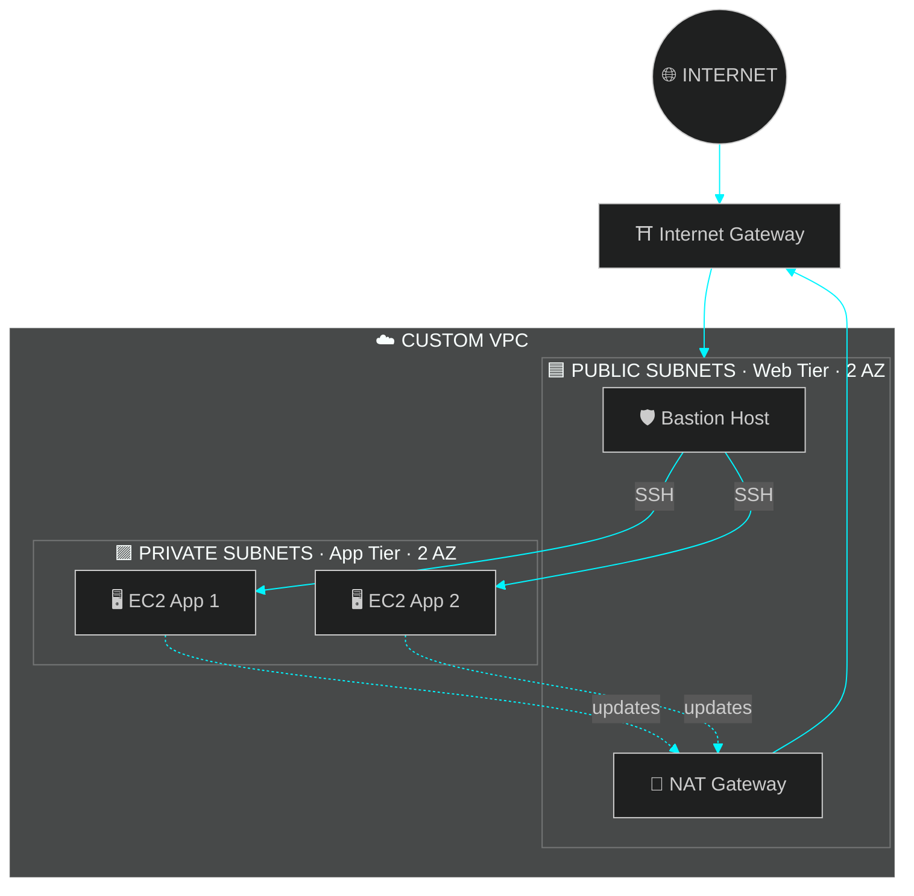

<!-- ╔══════════════════════════════════════════════════════════════╗ -->
<!-- ║                  ABHILASH T.A  //  CLOUD.SYS                 ║ -->
<!-- ╚══════════════════════════════════════════════════════════════╝ -->

<div align="center">


<br/>

<a href="https://www.linkedin.com/in/abhilash-t-anthony-74a529260"></a>
<a href="mailto:Abhilashantony17@gmail.com"></a>


<br/><br/>


</div>

<br/>

<!-- ═══════════════ BOOT SEQUENCE ═══════════════ -->
<h2 align="center">◢ SYSTEM BOOT ◣</h2>

```ruby
╔════════════════════════════════════════════════════════════════╗
║  ABHILASH-OS v2026.1   ::   CLOUD ENGINEER KERNEL              ║
╚════════════════════════════════════════════════════════════════╝

  [ OK ]  Loading identity ............. Abhilash T.A
  [ OK ]  Loading education ............ BCA Graduate · 2026
  [ OK ]  Mounting /cloud .............. AWS · VPC · IAM · S3 · EC2 · Lambda
  [ OK ]  Mounting /devops ............. Docker · Terraform · GitHub Actions
  [ OK ]  Mounting /scripts ............ Python · Bash · Linux
  [ OK ]  Applying policy .............. least-privilege · automate-everything
  [ OK ]  Starting service ............. build-in-public

  >> MISSION   : Build, secure & automate cloud infrastructure.
  >> MOTTO     : Learn fast. Ship real AWS projects.
  >> AVAILABLE : Cloud Engineer / Junior DevOps  [ READY TO DEPLOY ]
```

<br/>

<!-- ═══════════════ TECH ARSENAL ═══════════════ -->
<h2 align="center">◢ TECH ARSENAL ◣</h2>

<div align="center">


<br/><br/>


<br/><br/>

| ⚡ DOMAIN | 🛰️ TECHNOLOGIES |
|:---:|:---|
| **☁️ Compute** | `EC2` `Auto Scaling` `ELB` `Elastic Beanstalk` `Lambda` |
| **🌐 Networking** | `VPC` `NAT/IGW` `NACLs` `Security Groups` `Peering` `Transit Gateway` `Route 53` `CloudFront` |
| **💾 Storage** | `S3` `EBS` `EFS` `AWS Backup` |
| **🔐 Security** | `IAM` `STS` `KMS` `ACM` `GuardDuty` `Inspector` `Organizations` |
| **📡 Monitoring** | `CloudWatch` `CloudTrail` `Systems Manager` |
| **🔗 Integration** | `EventBridge` `SNS` `SQS` `SES` |
| **🗄️ Databases** | `RDS` `DynamoDB` `MongoDB` |

</div>

<br/>

<!-- ═══════════════ ARCHITECTURE ═══════════════ -->
<h2 align="center">◢ FEATURED ARCHITECTURE ◣</h2>
<p align="center"><code>Custom VPC · public/private tiers · bastion + NAT</code></p>



<br/>

<!-- ═══════════════ PROJECTS ═══════════════ -->
<h2 align="center">◢ MISSION LOG // PROJECTS ◣</h2>

<table align="center">
<tr>
<td width="50%" valign="top">

#### 🌐 `MISSION 01` · Custom VPC Architecture
> 2 public + 2 private subnets across 2 AZs, with bastion access, NAT Gateway, NACLs and VPC peering.


</td>
<td width="50%" valign="top">

#### 🔐 `MISSION 02` · Secure Static Website
> S3 hosting with least-privilege bucket policy, versioning and CORS, fronted by CloudFront, ACM HTTPS and a Route 53 custom domain.


</td>
</tr>
<tr>
<td width="50%" valign="top">

#### 🛡️ `MISSION 03` · IAM Security Lab
> Least-privilege policies, root hardening with MFA, and cross-account access using STS temporary credentials.


</td>
<td width="50%" valign="top">

#### ⚡ `MISSION 04` · Serverless EC2 Scheduler
> Lambda + EventBridge automatically start/stop EC2 on a schedule. Scoped execution role with CloudWatch Logs monitoring.


</td>
</tr>
<tr>
<td colspan="2" align="center" valign="top">

#### 📦 `MISSION 05` · Elastic Beanstalk Deployment
> Sample app on managed environments with auto scaling and load balancing.


</td>
</tr>
</table>

<br/>

<!-- ═══════════════ ROADMAP ═══════════════ -->
<h2 align="center">◢ CURRENT FOCUS // ROADMAP ◣</h2>

<div align="center">

```diff
+ [ACTIVE]   🏗️  Terraform Infrastructure as Code
+ [ACTIVE]   🐳  Dockerised applications
+ [ACTIVE]   🔁  GitHub Actions CI/CD pipelines
+ [ACTIVE]   ☁️  More real-world AWS builds
- [NEXT]     ☸️  Containers at scale (ECS / EKS)
- [NEXT]     📊  Observability & cost optimisation
```

</div>

<br/>

<!-- ═══════════════ GITHUB STATS ═══════════════ -->
<h2 align="center">◢ GITHUB TELEMETRY ◣</h2>

<div align="center">


<br/>


<br/><br/>


</div>

<br/>

<!-- ═══════════════ CONTACT ═══════════════ -->
<h2 align="center">◢ OPEN CHANNEL ◣</h2>

```ruby
  ┌──────────────────────────────────────────────────────────┐
  │   📡  TRANSMISSION OPEN                                  │
  │                                                          │
  │   ✉️   Abhilashantony17@gmail.com                         │
  │   🔗  linkedin.com/in/abhilash-t-anthony-74a529260       │
  │                                                          │
  │   > Have a cloud problem? Let's architect the fix.       │
  └──────────────────────────────────────────────────────────┘
```

<!-- ═══════════════ FOOTER ═══════════════ -->
<div align="center">


</div>
