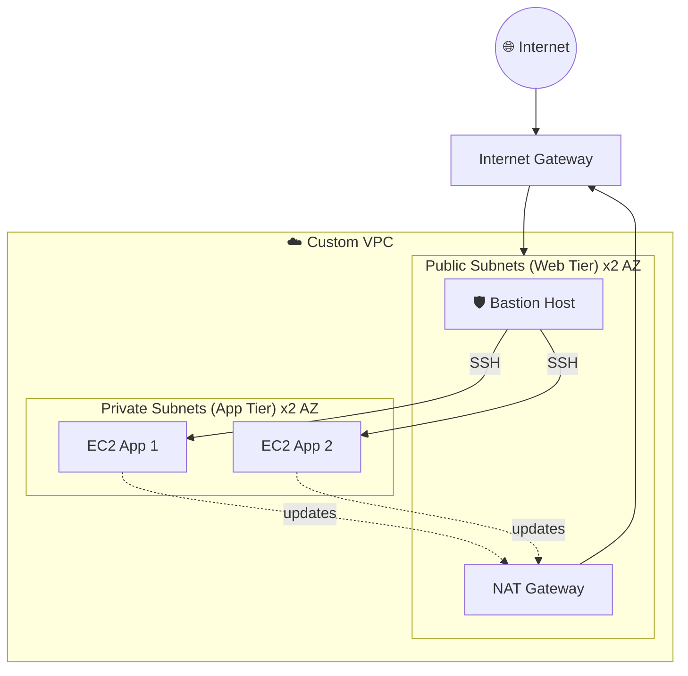

<!-- ============ HEADER ============ -->
<div align="center">


<br/>

<a href="https://www.linkedin.com/in/abhilash-t-anthony-74a529260"></a>
<a href="mailto:Abhilashantony17@gmail.com"></a>


</div>

<br/>

<!-- ============ TERMINAL ============ -->
```bash
abhilash@cloud:~$ whoami
> Cloud Engineer | BCA Graduate (2026) | AWS-focused builder

abhilash@cloud:~$ cat skills.conf
> cloud      = ["AWS", "VPC", "IAM", "S3", "EC2", "Lambda", "CloudFront"]
> devops     = ["Docker", "Terraform", "GitHub Actions", "CloudFormation"]
> scripting  = ["Python", "Bash", "Linux"]
> mindset    = "least-privilege, automate-everything, build-in-public"

abhilash@cloud:~$ cat mission.txt
> Build, secure and automate cloud infrastructure.
> Learn fast. Ship real AWS projects.

abhilash@cloud:~$ status --now
> [OK] Seeking Cloud Engineer / Junior DevOps opportunities
```

<br/>

<!-- ============ TECH STACK ============ -->
<h2 align="center">⚙️ TECH ARSENAL</h2>

<div align="center">


<br/><br/>


</div>

<br/>

<div align="center">

| 🌩️ DOMAIN | ⚡ TECHNOLOGIES |
|:---|:---|
| **Compute** | EC2 · Auto Scaling · ELB · Elastic Beanstalk · Lambda |
| **Networking** | VPC · NAT/IGW · NACLs · Security Groups · Peering · Transit Gateway · Route 53 · CloudFront |
| **Storage** | S3 · EBS · EFS · AWS Backup |
| **Security** | IAM · STS · KMS · ACM · GuardDuty · Inspector · Organizations |
| **Monitoring** | CloudWatch · CloudTrail · Systems Manager |
| **Integration** | EventBridge · SNS · SQS · SES |
| **Databases** | RDS · DynamoDB · MongoDB |

</div>

<br/>

<!-- ============ ARCHITECTURE ============ -->
<h2 align="center">🛰️ FEATURED ARCHITECTURE</h2>
<p align="center"><i>Custom VPC: public/private tiers with bastion + NAT</i></p>



<br/>

<!-- ============ PROJECTS ============ -->
<h2 align="center">🚀 MISSION LOG: PROJECTS</h2>

<table align="center">
<tr>
<td width="50%" valign="top">

### 🌐 Custom VPC Architecture
2 public + 2 private subnets across 2 AZs. Bastion host access, NAT Gateway, NACLs and VPC peering.


</td>
<td width="50%" valign="top">

### 🔐 Secure Static Website
S3 hosting with least-privilege bucket policy, versioning, CORS, CloudFront, ACM HTTPS and Route 53 custom domain.


</td>
</tr>
<tr>
<td width="50%" valign="top">

### 🛡️ IAM Security Lab
Least-privilege policies, root hardening with MFA, cross-account access using STS temporary credentials.


</td>
<td width="50%" valign="top">

### ⚡ Serverless EC2 Scheduler
Lambda + EventBridge to automatically start/stop EC2 on a schedule. Scoped execution role, CloudWatch Logs monitoring.


</td>
</tr>
</table>

<div align="center">

### 📦 Elastic Beanstalk Deployment
Sample app on managed environments with scaling and load balancing.

</div>

<br/>

<!-- ============ CURRENTLY ============ -->
<h2 align="center">🔭 CURRENT FOCUS</h2>

<div align="center">

`🏗️ Terraform IaC` &nbsp; `🐳 Dockerised apps` &nbsp; `🔁 GitHub Actions CI/CD` &nbsp; `☁️ More real-world AWS builds`

</div>

<br/>

<!-- ============ FOOTER ============ -->
<div align="center">


</div>
